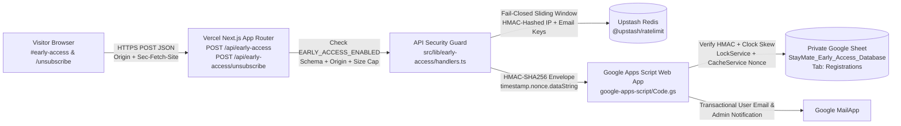
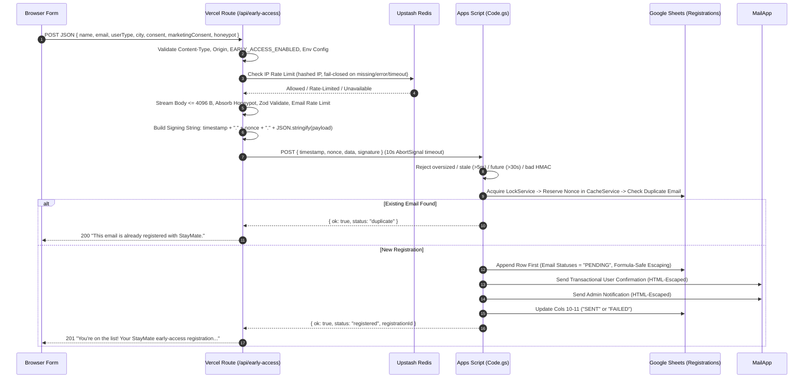

# StayMate Early-Access Registration — System Architecture

## 1. Overview

StayMate's early-access registration system connects the existing pre-launch Next.js App Router marketing website hosted on Vercel to a private Google Sheets datastore (`StayMate_Early_Access_Database`) managed by a hardened Google Apps Script Web App (`google-apps-script/Code.gs`), protected by Upstash Redis distributed rate limiting and HMAC-SHA256 request authentication.

---

## 2. End-to-End Request Architecture

---

## 3. Registration & Failure-Safe Write Sequence

---

## 4. Component Map

| Layer | Responsibility | Implementation Location |
| --- | --- | --- |
| **UI & Consent Separation** | Preserves visual design, renders closed-flag gate, collects registration + separate optional marketing consent, handles duplicate/success/error states while preserving input values. | [`src/components/sections/EarlyAccess.tsx`](../src/components/sections/EarlyAccess.tsx), [`src/app/page.tsx`](../src/app/page.tsx) |
| **Consent Withdrawal UI** | Allows registered users to withdraw optional marketing consent cleanly via email. | [`src/components/UnsubscribeForm.tsx`](../src/components/UnsubscribeForm.tsx), [`src/app/unsubscribe/page.tsx`](../src/app/unsubscribe/page.tsx) |
| **Server Endpoints** | Strictly `POST`-only Next.js Route Handlers with `force-dynamic`, security headers, and `no-store` responses. | [`src/app/api/early-access/route.ts`](../src/app/api/early-access/route.ts), [`src/app/api/early-access/unsubscribe/route.ts`](../src/app/api/early-access/unsubscribe/route.ts) |
| **Validation, Config & Crypto** | Zod allowlists, fail-closed server config (`EARLY_ACCESS_ENABLED`), HMAC-SHA256 envelope signing, trusted Vercel proxy IP extraction, bounded streaming body reader. | [`src/lib/early-access/schema.ts`](../src/lib/early-access/schema.ts), [`src/lib/early-access/config.ts`](../src/lib/early-access/config.ts), [`src/lib/early-access/hmac.ts`](../src/lib/early-access/hmac.ts), [`src/lib/api-guard.ts`](../src/lib/api-guard.ts) |
| **Distributed Abuse Defense** | Upstash Redis sliding-window rate limits keyed by keyed HMAC hashes (`5 / 10m` per IP, `3 / 1h` per email); strictly fails closed on missing config or timeouts. | [`src/lib/early-access/upstash-limit.ts`](../src/lib/early-access/upstash-limit.ts) |
| **Database & Mail Processing** | Independently validates inputs, verifies HMAC & nonces, serializes writes under `LockService`, neutralizes formulas, writes 12-column schema, sends responsive HTML emails, tracks status, provides owner-only `retryFailedEmails()`. | [`google-apps-script/Code.gs`](../google-apps-script/Code.gs) |

---

## 5. Google Sheets Schema (`StayMate_Early_Access_Database` -> `Registrations`)

1. `Registration_ID` — Unique `SM-XXXXXXXXXX` identifier.
2. `Full_Name` — Formula-sanitized trimmed full name.
3. `Email` — Normalized lowercase email (`3–254` chars).
4. `User_Type` — Allowlisted category (`Student`, `Working Professional`, or `Property Owner`).
5. `Preferred_City` — Optional sanitized city string.
6. `Marketing_Consent` — Explicit boolean (`true` only if optional marketing box was checked).
7. `Consent_Timestamp` — ISO UTC timestamp of opt-in, empty if not opted in, or `"Withdrawn <ISO>"` after unsubscribe.
8. `Registered_At` — ISO UTC timestamp of row creation.
9. `Registration_Status` — `REGISTERED`.
10. `Confirmation_Email_Status` — `PENDING` -> `SENT` or `FAILED`.
11. `Admin_Notification_Status` — `PENDING` -> `SENT` or `FAILED`.
12. `Source` — Static server source marker (`staymate-website`).
